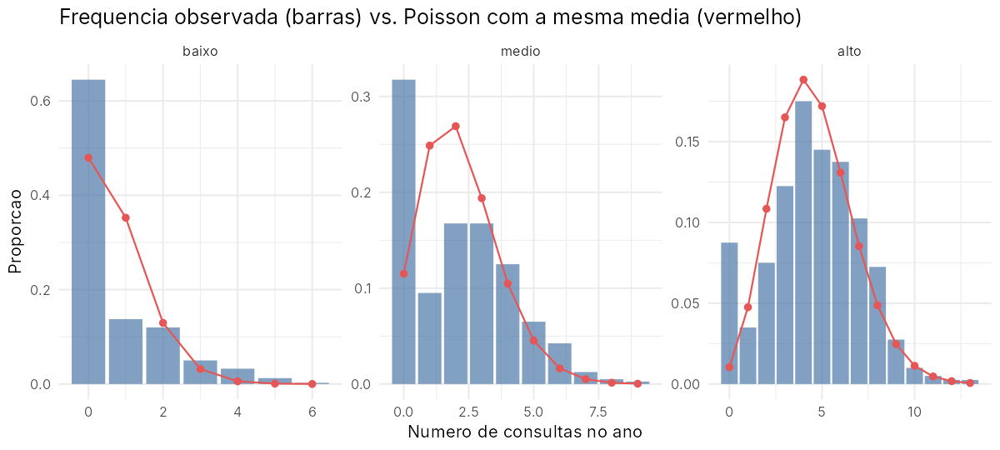
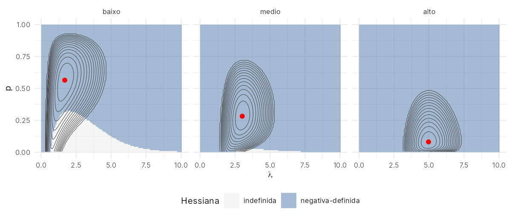
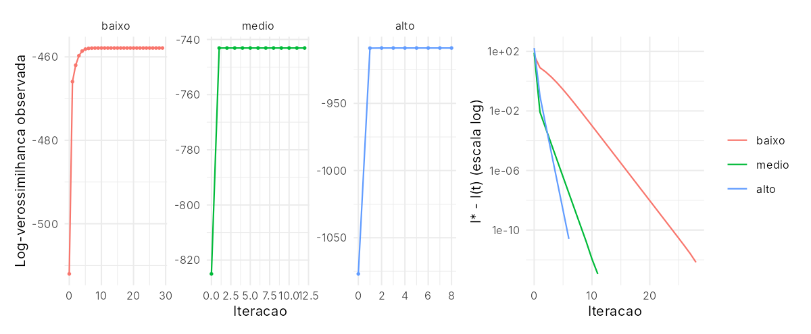
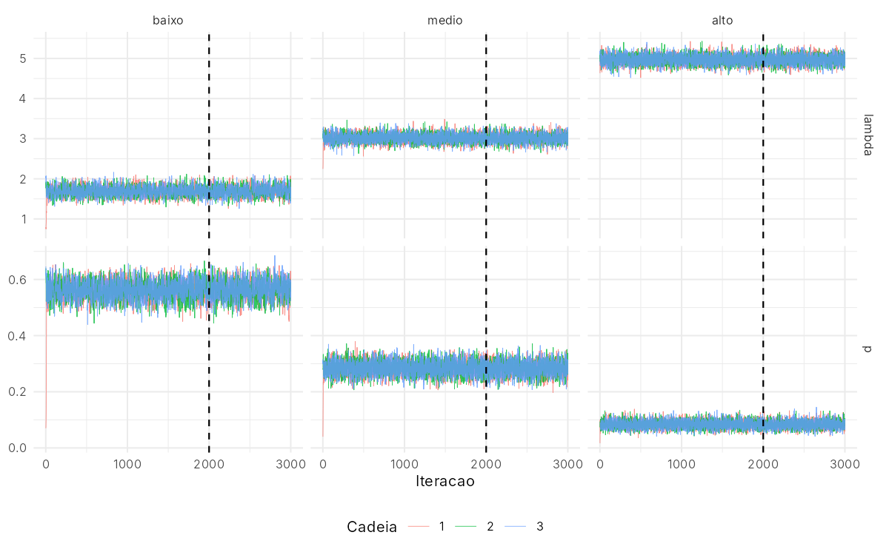
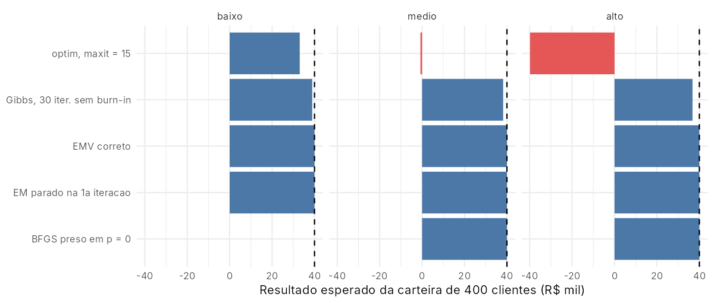

# 🩺 Modelo de Poisson Inflado em Zero: Estimação e Aplicação Prática

### 📌 Sobre o Projeto

Laboratório 2 da disciplina **ME524 - Computação Aplicada à Estatística** (Unicamp, 2026). O objetivo é estimar os parâmetros de um modelo de **Poisson inflado em zero (ZIP)** para o número anual de consultas médicas de clientes de um plano de saúde, separadamente para cada perfil de risco. A estimação usa **otimização numérica** (`optim()` e Newton-Raphson), o **algoritmo EM** e **inferência Bayesiana via Gibbs Sampler**. Depois, as estimativas são usadas para **precificar o plano**.

- **Disciplina:** ME524
- **Entrega:** relatório em grupo (3 a 4 integrantes), com código e texto explicativo
- **Relatório final:** [`docs/relatorio/relatorio.pdf`](docs/relatorio/relatorio.pdf)

---

### 📄 Dados
- `visitas_medicas.csv`:
    - Base **simulada** com 1.200 clientes (400 por perfil de risco).
    - Colunas: `id`, `perfil` (`baixo`, `medio`, `alto`) e `visitas` (número de consultas no ano).
    - Parte dos clientes nunca consulta (zeros estruturais); os demais consultam segundo uma Poisson.

---

### 🎯 Perguntas a Responder

| Parte | Questão | Tipo | Script |
|---|---|---|---|
| 1.1 | EMV via `optim()` com reparametrização e vários inícios | Implementação | [`q1_1_optim.R`](scripts/parte1_otimizacao/q1_1_optim.R) |
| 1.2 | **Q1** Equações de score | Derivação | [`q1_equacoes_score.R`](scripts/parte1_otimizacao/q1_equacoes_score.R) |
| 1.2 | **Q2** Hessiana, viabilidade e 10 iterações de Newton-Raphson | Implementação | [`q2_newton_raphson.R`](scripts/parte1_otimizacao/q2_newton_raphson.R) |
| 2 | **Q3** Passos E e M | Derivação | [`q3_derivacao_em.R`](scripts/parte2_em/q3_derivacao_em.R) |
| 2 | **Q4** Algoritmo EM e gráfico de convergência | Implementação | [`q4_em.R`](scripts/parte2_em/q4_em.R) |
| 3 | **Q5** Condicionais completas (Beta, Gamma, Bernoulli) | Derivação | [`q5_condicionais.R`](scripts/parte3_mcmc/q5_condicionais.R) |
| 3 | **Q6** Gibbs Sampler, estimativas e IC de credibilidade 95% | Implementação | [`q6_gibbs.R`](scripts/parte3_mcmc/q6_gibbs.R) |
| 3 | **Q7** Diagnóstico de convergência | Análise | [`q7_diagnostico.R`](scripts/parte3_mcmc/q7_diagnostico.R) |
| 3 | **Q8** Bayes × EMV (EM e `optim()`) | Análise | [`q8_comparacao.R`](scripts/parte3_mcmc/q8_comparacao.R) |
| 4 | **Q9** Valor esperado $E[Y]$ | Derivação | [`q9_valor_esperado.R`](scripts/parte4_aplicacao/q9_valor_esperado.R) |
| 4 | **Q10** Valor anual a cobrar por perfil e método | Análise | [`q10_premio.R`](scripts/parte4_aplicacao/q10_premio.R) |
| 4 | **Q11** Impacto de um método mal-convergido | Análise | [`q11_malconvergido.R`](scripts/parte4_aplicacao/q11_malconvergido.R) |

Nas questões de derivação, o texto matemático fica na seção correspondente do relatório e o script faz uma **verificação numérica** do resultado derivado (por exemplo, gradiente numérico × score analítico).

---

## 🔍 Profiling do Dataset

O dataset [`data/raw/visitas_medicas.csv`](data/raw/visitas_medicas.csv) tem:

| Perfil | n | Zeros | Prop. zeros | Média | Variância | $e^{-\bar y}$ (Poisson) |
|---|---:|---:|---:|---:|---:|---:|
| baixo | 400 | 258 | 64,5% | 0,735 | 1,453 | 48,0% |
| medio | 400 | 127 | 31,8% | 2,163 | 3,896 | 11,5% |
| alto | 400 | 35 | 8,8% | 4,565 | 6,266 | 1,0% |

- **Excesso de zeros:** em todos os perfis a proporção de zeros é muito maior que a prevista por uma Poisson com a mesma média.
- **Sobredispersão:** a variância supera a média, como prevê o ZIP: $\operatorname{Var}(Y) = (1-p)\lambda(1+p\lambda)$.
- **Valores nulos:** nenhum. O par (`id`, `perfil`) é único (os `id` se repetem entre perfis).



---

## 🧮 Modelo e Arquitetura

$$P(Y=0) = p + (1-p)e^{-\lambda}, \qquad P(Y=k) = (1-p)\frac{e^{-\lambda}\lambda^k}{k!},\ k \ge 1$$

```
data/raw/visitas_medicas.csv
        │
        ▼
 estatísticas suficientes por perfil (n0, n+, S)
        │
        ├──► Parte 1: optim() (logit p, log λ) + Newton-Raphson (score/Hessiana analíticos)
        ├──► Parte 2: algoritmo EM (aumento com Z_i latente)
        └──► Parte 3: Gibbs Sampler (Beta / Gamma / Binomial), 3 cadeias + diagnósticos
        │
        ▼
 Parte 4: E[Y] = (1 − p)λ  →  prêmio = 250·E[Y] + 100  →  impacto de má convergência
```

Detalhes das decisões do modelo em [`.ai/modelagem.md`](.ai/modelagem.md).

---

## 📊 Principais Resultados

| Perfil | $\hat p$ (EMV) | $\hat\lambda$ (EMV) | $p$ Bayes [IC 95%] | $\lambda$ Bayes [IC 95%] | Prêmio anual |
|---|---:|---:|---:|---:|---:|
| baixo | 0,5644 | 1,6874 | 0,564 [0,498; 0,624] | 1,689 [1,457; 1,946] | R$ 283,75 |
| medio | 0,2822 | 3,0127 | 0,283 [0,236; 0,333] | 3,014 [2,799; 3,238] | R$ 640,62 |
| alto | 0,0811 | 4,9679 | 0,083 [0,057; 0,113] | 4,969 [4,739; 5,205] | R$ 1.241,25 |

- **Os métodos concordam:** `optim()`, Newton-Raphson, EM e a solução de referência (`uniroot`) coincidem até a 6ª casa decimal, e as medianas Bayesianas e os ICs ficam praticamente iguais ao EMV e aos ICs de Wald.
- **Falsa convergência do BFGS:** a partir de inícios com $p_0$ alto, o BFGS para em $p \approx 0$ e reporta `convergence = 0`. Isso aconteceu em 4/20 inícios no perfil médio e 9/20 no alto. O Nelder-Mead acertou nos 20 inícios.
- **Prêmio robusto ao método:** no EMV vale $(1-\hat p)\hat\lambda = \bar y$, então o prêmio é sempre $250\bar y + 100$. O EM satisfaz essa igualdade já a partir da 1ª iteração.
- **Má convergência custa caro:** um `optim()` interrompido cedo levaria o perfil alto a um resultado esperado de **−R$ 39,8 mil** em 400 clientes, em vez de +R$ 40 mil.

| Newton-Raphson × concavidade | Convergência do EM |
|---|---|
|  |  |
| **Trajetórias do Gibbs** | **Impacto de má convergência** |
|  |  |

Respostas completas em [`docs/respostas.md`](docs/respostas.md).

---

## 🛠️ Configuração do Projeto

### Pré-requisitos

| Ferramenta | Versão mínima |
|-----------|--------------|
| R | 4.3.0 |
| LaTeX (xelatex) | só para gerar o relatório em PDF |

### Instalação

```r
install.packages(c("ggplot2", "patchwork", "coda", "testthat", "rmarkdown", "knitr", "lintr"))
```

### Variáveis de Ambiente (opcional)

```bash
cp .env.example .env
# Edite .env se quiser fixar RANDOM_SEED / N_ITER_GIBBS / BURN_IN / DATA_PATH
```

Consulte [`.env.example`](.env.example) para a lista completa.

---

## 🏡 Rodando localmente

Todos os comandos rodam **a partir da raiz** do repositório.

```bash
# Todas as perguntas, na ordem do enunciado
Rscript scripts/run_all.R --seed 524 --n-iter 20000 --burn-in 2000

# Ou uma pergunta isolada (dependências são recalculadas sob demanda)
Rscript scripts/parte3_mcmc/q7_diagnostico.R
```

Cada script salva suas tabelas em `data/processed/<parte>/*.rds` (fora do git) e suas figuras em `docs/figuras/<parte>/*.png` (versionadas).

### Relatório

```r
rmarkdown::render("docs/relatorio/relatorio.Rmd")   # gera docs/relatorio/relatorio.pdf
```

O relatório executa os scripts de cada pergunta no ponto correspondente, mostra o código na íntegra e monta as tabelas e figuras a partir dos resultados.

### Testes e lint

```r
testthat::test_dir("tests/testthat")
lintr::lint_dir("R"); lintr::lint_dir("scripts"); lintr::lint_dir("tests")
```

---

## 💾 Estrutura de Pastas

```
data/
  raw/                         # Dataset original do enunciado (versionado, não editar)
  processed/                   # Resultados intermediários (.rds) gerados pelos scripts (fora do git)
R/                             # Funções reutilizáveis (testadas)
  config.R                     # Constantes do enunciado e parâmetros de execução (.env)
  dados.R                      # Leitura/validação do CSV e estatísticas suficientes
  verossimilhanca.R            # Log-verossimilhança, score, Hessiana, EMV de referência, IC de Wald
  otimizacao.R                 # optim() reparametrizado e múltiplos inícios
  newton_raphson.R             # Newton-Raphson e início pelo método dos momentos
  em.R                         # Algoritmo EM
  gibbs.R                      # Gibbs Sampler, resumo a posteriori e diagnósticos
  aplicacao.R                  # E[Y], Var(Y) e prêmio anual
  utils.R                      # Entrada/saída de resultados e figuras, formatação
scripts/                       # Um script por pergunta, separados por parte
  run_all.R                    # Roda todas as perguntas na ordem
  parte0_dados/                # Resumo descritivo
  parte1_otimizacao/           # 1.1, Q1, Q2
  parte2_em/                   # Q3, Q4
  parte3_mcmc/                 # Q5, Q6, Q7, Q8
  parte4_aplicacao/            # Q9, Q10, Q11
docs/
  lab2.pdf                     # Enunciado completo
  enunciado.md                 # Resumo do enunciado
  respostas.md                 # Respostas resumidas (números + interpretação)
  figuras/                     # Figuras geradas, uma pasta por parte
  relatorio/
    relatorio.Rmd              # Documento principal (junta as seções)
    relatorio.pdf              # Relatório renderizado (entrega)
    secoes/                    # Uma seção por parte: 00_introducao ... 05_conclusao
tests/
  testthat/                    # Testes unitários espelhando R/
DESCRIPTION                    # Metadados do projeto e dependências
```

## 🤖 Contexto para IAs

A pasta `.ai/` contém os arquivos de contexto e as diretrizes do projeto para ferramentas de IA (Claude Code, Cursor, Copilot etc.):

| Arquivo | Descrição |
|---------|-----------|
| [.ai/contexto.md](.ai/contexto.md) | Visão geral: stack, fluxo principal e índice dos demais arquivos |
| [.ai/padroes-codigo.md](.ai/padroes-codigo.md) | Padrões de R, de scripts por pergunta e de testes usados no projeto |
| [.ai/modelagem.md](.ai/modelagem.md) | Decisões do modelo estatístico (ADRs) |

## 📄 Documentação

| Arquivo | Descrição |
|---------|-----------|
| [docs/enunciado.md](docs/enunciado.md) | Resumo do enunciado e das perguntas a responder |
| [docs/respostas.md](docs/respostas.md) | Respostas resumidas, pergunta a pergunta |
| [docs/relatorio/relatorio.Rmd](docs/relatorio/relatorio.Rmd) | Relatório executável (código + texto) |
| [docs/relatorio/relatorio.pdf](docs/relatorio/relatorio.pdf) | Relatório renderizado para entrega |

---

### 🧪 Roteiro de Execução

1. Calcular as estatísticas suficientes $(n_0, n_+, S)$ de cada perfil.
2. Maximizar a verossimilhança com `optim()` na escala $(\operatorname{logit} p, \log\lambda)$ a partir de vários inícios.
3. Derivar o score e a Hessiana, analisar a concavidade e rodar 10 iterações de Newton-Raphson.
4. Derivar e implementar o algoritmo EM, monitorando a log-verossimilhança.
5. Derivar as condicionais completas e implementar o Gibbs Sampler (3 cadeias, burn-in, diagnósticos).
6. Comparar EMV e Bayes; derivar $E[Y]$ e calcular o prêmio anual por perfil e por método.
7. Discutir o impacto de estimativas mal-convergidas sobre as finanças do plano.

---

### ✅ Checklist de Entregas

[✓] 1.1 EMV via `optim()` com reparametrização e vários pontos iniciais

[✓] Q1 Equações de score (derivação + verificação numérica)

[✓] Q2 Hessiana, viabilidade do Newton-Raphson e 10 iterações

[✓] Q3 Derivação dos passos E e M

[✓] Q4 Algoritmo EM + gráfico de convergência

[✓] Q5 Derivação das condicionais completas

[✓] Q6 Gibbs Sampler (≥ 10.000 iterações, burn-in 2.000) + IC de credibilidade

[✓] Q7 Diagnóstico de convergência (trajetórias, $\hat R$, ESS, ACF)

[✓] Q8 Comparação Bayes × EMV

[✓] Q9 Derivação de $E[Y]$

[✓] Q10 Tabela de prêmios por perfil e método

[✓] Q11 Análise de métodos mal-convergidos

[✓] Relatório final com código e texto explicativo

[✓] Revisão final do grupo antes da entrega
